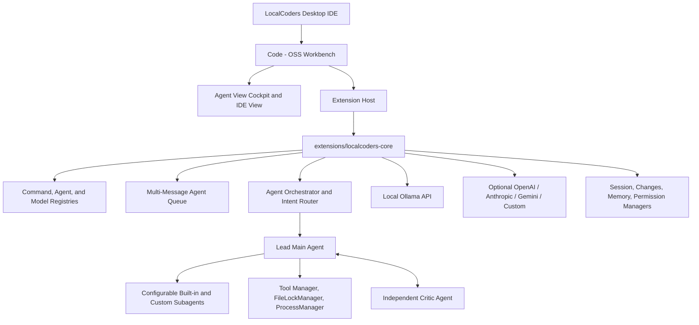

# LocalCoders

**Open-Source, Local-First Multi-Agent AI Coding IDE Built on Code - OSS**

LocalCoders is a standalone desktop AI coding IDE built on Microsoft's open-source Code - OSS foundation with a dedicated Agent View cockpit, multi-agent planning and verification, continuous Critic review cycles, local Ollama inference, and optional cloud provider routing.

---

## Core Capabilities

- **Dual Workbench Modes (Agent View and IDE View)**: Switch from the titlebar between a distraction-free Agent workspace (`Ctrl+Shift+A`) and the full Code - OSS desktop IDE (`Ctrl+Shift+E`) with Monaco editors, Explorer, Git, integrated terminal, debugging, and Open VSX extensions.
- **LC Aura Desktop Identity and Device Profile**: Uses the custom LC Aura desktop branding (`branding/localcoders-logo.svg`, `branding/localcoders-icon.png`) for application and launcher assets, while displaying the logged-in device OS username in the Agents sidebar header.
- **Live Hardware Telemetry and Resource Management**: Displays live Ollama connection status (`LOCAL Ollama Ready`), CPU model/cores/utilization, system RAM, and NVIDIA GPU VRAM, utilization, and temperature. Automatically releases active Ollama models from VRAM when closing LocalCoders (`stopOllamaOnExit`).
- **Prompt Intent Routing and Safe Execution**:
  - Classifies user messages into casual conversation (`greeting`), read-only Q&A (`question`), execution-only commands (`execute_task`), planning (`plan`), and software implementation (`coding_task`).
  - Casual chat and post-cancellation greetings run directly without triggering file edits or coding plans, and cancelled task turns are stripped from active history.
  - Execution-only requests (such as running or starting an already finished application) execute commands via `run_command` or `start_process` with write/edit tools disabled so completed source files are not rewritten.
- **Iterative Multi-Agent Orchestration and Configurable Subagents**:
  - **Lead Main Agent**: Plans tasks, writes and edits workspace files, executes verification commands, coordinates delegated work, and applies Critic feedback.
  - **Built-in and Custom Subagents**: Configure both built-in specialists (`Frontend Specialist`, `Backend Specialist`, `Test Engineer`, `Debugging Specialist`) and custom subagents from the **Agents** modal. Each subagent supports its own model dropdown (`Same as coding model` or any discovered model), custom editable instructions, enable/disable toggle, and lock-safe parallel scheduling via `FileLockManager`.
  - **Continuous Critic Review Loop (`Code -> Critic Review -> Feedback -> Fix -> Verify -> Re-review`)**: Audits Git diffs, non-Git workspace changes, current source files on disk, and test output. Defaults to `maxCriticCycles: 0` (continues review-fix cycles until approved with passing tests or cancelled by the user), with optional finite caps configurable in settings or the **Agents** modal. Includes repeated failed edit/command loop protection (`createTurnProgressGuard`) and line-numbered mismatch context in `edit_file`.
- **Multi-Message Agent Queue**: Submit follow-up instructions at any time while the agent is busy without waiting for the current task to finish. `MessageQueueManager` executes queued items one at a time in strict FIFO order per session with Send Now, Edit, Reorder, Pause/Resume, Retry, Delete, Skip, restart persistence across reloads, and `/queue` controls.
- **35-Command Slash Command System**: Centralized registry (`docs/SLASH_COMMANDS.md`) with keyboard-navigable composer autocomplete across Agent View and IDE Chat Sidebar (`/bypass`, `/normal`, `/auto-approve`, `/permissions`, `/agent`, `/plan`, `/ask`, `/review`, `/model`, `/models`, `/model-info`, `/reasoning`, `/new`, `/clear`, `/sessions`, `/rename`, `/delete-session`, `/export`, `/compact`, `/undo`, `/redo`, `/terminal`, `/git`, `/files`, `/search`, `/diagnostics`, `/run`, `/test`, `/agents`, `/agent-create`, `/agent-status`, `/agent-stop`, `/mcp`, `/queue`, `/help`).
- **Central Model and Provider Registry**: Discovers live installed Ollama models (plus hardware-aware recommendations), manages context windows and reasoning efforts, and supports OpenAI, Anthropic, Google Gemini, OpenRouter, and custom OpenAI-compatible endpoints without synthetic models or silent fallback.
- **Git and Non-Git Change Tracking**: Computes unified diffs, line additions/removals, per-file or batch Accept/Reject actions, and workspace-scoped `/undo` / `/redo` operation history across Git repos and plain folders.
- **Terminal, Virtual Environments, and Interactive Process Control**: Defaults POSIX shells to `/bin/bash`, exposes workspace `.venv`/`venv/bin` and `node_modules/.bin` on `PATH`, supports non-blocking `stdin` on `run_command`, and manages GUI/server/long-running processes via `start_process`, `write_stdin`, `read_output`, and `terminate_process`.
- **Permission Policies and Hard Security Boundaries**: Supports `Ask Before Actions`, `Smart Approval`, and `Bypass Permissions` while enforcing workspace path containment, secret redaction, OS permission checks, and explicit confirmation gates on destructive actions.
- **Minimalist Sessions Sidebar and Live Thinking Drawer**: Manage sessions sorted by Recent, alphabetical order, or folder groups with inline rename/delete, rendered Markdown responses, and per-agent reasoning entries grouped cleanly by turn.

---

## System Architecture



---

## Prerequisites

- Linux desktop environment (X11 or Wayland)
- Node.js 20 or later and npm
- Git
- Ollama running locally at `http://127.0.0.1:11434` (with a local coding model installed, such as `qwen3.8:27b` or `qwen2.5-coder:7b`)

---

## Development Setup and Testing

### 1. Install Dependencies and Compile Extension

```bash
git clone https://github.com/luongjuan123/LocalCoders.git
cd LocalCoders

npm install
npm --prefix extensions/localcoders-core install
npm --prefix extensions/localcoders-core run compile
```

### 2. Run Automated Test Suite

```bash
npm test
```

The test suite runs `100` automated tests across `14` suites covering intent classification, execute-only safeguards, infinite and bounded Critic review cycles, loop/stall guards, per-subagent model and instruction configuration, multi-message FIFO queuing, slash commands, model routing, Ollama lifecycle management, interactive stdin and virtual environments, Git and non-Git change tracking, file locks, and Agent View / Chat View UI scripts.

### 3. Reconstruct Full Code - OSS Desktop Workbench

The `vscode-src/` runtime build directory is excluded from version control due to upstream Code - OSS history and native dependency size. Custom workbench, titlebar, and product patches are stored in `patches/vscode-workbench.patch`:

```bash
# Clone upstream Code - OSS into vscode-src (if setting up from scratch)
git clone --depth 1 https://github.com/microsoft/vscode.git vscode-src
git -C vscode-src apply ../patches/vscode-workbench.patch

# Sync extension source into Code - OSS built-in extensions
rsync -a --delete extensions/localcoders-core/src/ vscode-src/extensions/localcoders/src/
npm --prefix vscode-src/extensions/localcoders install
npm --prefix vscode-src/extensions/localcoders run compile
```

### 4. Launch Desktop Application

```bash
# Open current workspace
./bin/localcoders .

# Or open any target project folder
./bin/localcoders /path/to/project
```

---

## Project Structure

```text
LocalCoders/
├── bin/
│   └── localcoders                     Desktop application launcher script
├── branding/
│   ├── localcoders-logo.svg            Vector LC Aura logo asset
│   ├── localcoders-icon.png            Desktop application icon asset
│   └── product.json                    Code - OSS product configuration
├── docs/
│   ├── ARCHITECTURE.md                 Multi-agent workbench architecture notes
│   └── SLASH_COMMANDS.md               Complete slash command reference
├── electron/                           Electron shell entry and IPC services
├── extensions/localcoders-core/        Built-in AI IDE extension source
│   └── src/
│       ├── agents/                     MainAgent, Subagent, CriticAgent, Orchestrator, Registry, Loop Guards
│       ├── commands/                   Central 35-command slash registry, parser, executor, undo/redo history
│       ├── context/                    ChangesManager, CodebaseIndexer, MemoryManager
│       ├── mcp/                        MCP server host integration
│       ├── models/                     Central ModelProviderRegistry and LLMRouter
│       ├── ollama/                     Ollama streaming client, stall watchdog, catalogue, hardware telemetry
│       ├── security/                   PermissionManager and workspace security boundaries
│       ├── sessions/                   SessionManager and MessageQueueManager persistence
│       ├── tools/                      Filesystem, Git, Terminal, Process, Search, Browser, DB tools
│       └── views/                      AgentWorkspaceEditorPanel, ChatView, Queue UI, Modals, Sessions UI
├── patches/
│   └── vscode-workbench.patch          Code - OSS workbench, titlebar, and branding patches
├── src/                                React desktop shell components
├── test/                               Automated Node test suite (100 tests across 14 suites)
└── package.json
```

---

## License

MIT License
