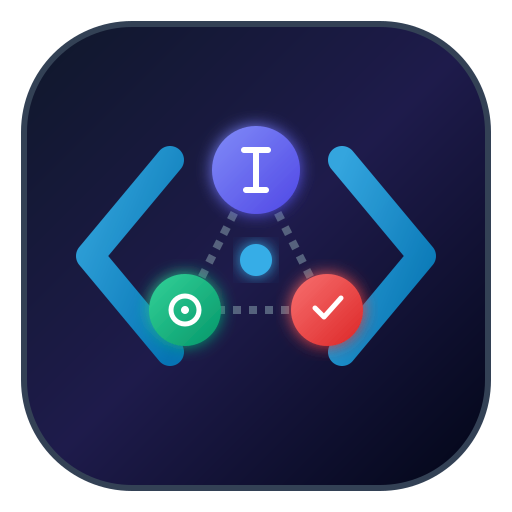
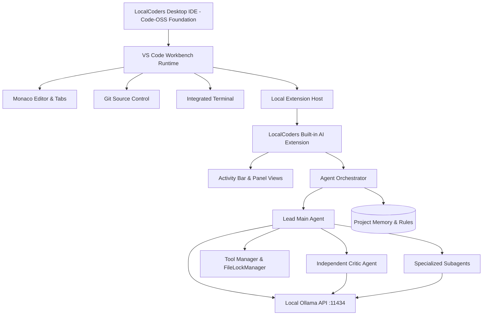

# LocalCoders 🚀
### Open-Source, Standalone Multi-Agent AI Coding IDE Built on Code - OSS
*Inspired by Google Antigravity IDE, Cursor, and Windsurf — 100% Local-First & Powered by Ollama*

---

LocalCoders is a complete, standalone desktop AI coding IDE built directly on Microsoft's open-source **Code - OSS** foundation. It is not an extension to be manually installed into VS Code, nor a browser app, but an independent, branded desktop IDE that retains the full VS Code workbench (editor tabs, file explorer, integrated terminal, source control, debugger, Open VSX extensions) and integrates a powerful multi-agent AI coding core natively into the desktop shell.



---

## ✨ Key Capabilities

- **Genuine Code - OSS Desktop Workbench**: Full VS Code desktop IDE runtime with Electron, Monaco Editor, multi-tab layout, workspace tree, integrated terminal, Git source control, debugging infrastructure, and Open VSX extensions marketplace.
- **Dedicated LocalCoders Activity Bar & Panels**:
  - **AI Multi-Agent Chat View**: Conversational interface for assigning coding tasks, refactorings, test generation, and codebase analysis.
  - **Agent Team Manager**: Configure the mandatory Lead Main Agent and specialized Subagents (*Frontend Developer*, *Backend Developer*, *Database Engineer*, *Software Architect*, *Debugging Specialist*, *Test Engineer*, *Security Auditor*, *Performance Engineer*, etc.).
  - **Model Manager**: Direct Ollama model discovery (`qwen3.8:27b`, `deepseek-r1`, `qwen2.5-coder`), hardware telemetry (CPU, GPU, RAM), and one-click pulling.
  - **Live Task Monitor**: Real-time visual progress of task plans, subagent delegation, tool executions, and file edits.
  - **Critic Agent Audit Panel**: Independent code review panel auditing diffs for edge cases, race conditions, injection flaws, and regressions.
  - **Project Memory & Rules View**: Project-level memory (`.localcoders/project-memory.md`) and persistent coding standards (`.localcoders/rules.md`).
- **Safe Tool Execution & Conflict Management**:
  - `read_file`, `write_file`, `edit_file`, `delete_file`
  - `list_directory`, `search_codebase`, `search_symbols`
  - `run_command`, `run_tests`, `run_build`, `run_lint`
  - `inspect_git_status`, `read_git_diff`, `stage_file`, `create_checkpoint`
  - **FileLockManager**: Enforces mutexes on files being edited to prevent concurrent agent overwrites.
  - **Human-in-the-Loop Approvals**: Interactive approval cards for destructive operations and git reversions.
- **100% Local Inference via Ollama**: Direct connection to local Ollama (`http://127.0.0.1:11434`), zero mandatory cloud API subscriptions, zero telemetry.

---

## 🖥️ System Architecture



---

## 🚀 Desktop Launching

### Option 1: Desktop Icon
Double-click the **LocalCoders** icon on your Desktop (`~/Desktop/LocalCoders.desktop`), or launch it from your Linux application menu (`~/.local/share/applications/localcoders.desktop`).

### Option 2: Terminal Launcher
```bash
# Launch LocalCoders opening the current directory
./bin/localcoders .

# Or open any specific workspace
./bin/localcoders "/home/juan/Work Space/LocalCoders"
```

---

## 🛠️ Building & Verification

```bash
# 1. Run the automated test suite (23 tests across 7 test suites)
npm test

# 2. Compile Code - OSS client and workbench
cd /home/juan/localcoders-oss
export VSCODE_SKIP_NODE_VERSION_CHECK=1
pnpm run compile

# 3. Compile LocalCoders built-in extension
cd /home/juan/localcoders-oss/extensions/localcoders
npm run compile
```

---

## 📂 Project Structure

```
LocalCoders/
├── bin/
│   └── localcoders                     # Executable desktop application launcher
├── branding/
│   ├── localcoders-logo.svg            # Official vector branding
│   └── localcoders-icon.png            # High-resolution 512x512 app icon
├── vscode-src/ -> /home/juan/localcoders-oss # Symlink to Code - OSS repository
├── extensions/localcoders-core/        # LocalCoders built-in extension source
│   ├── package.json                    # View containers, commands & menus
│   └── src/
│       ├── agents/                     # Main agent, Subagents, Critic, Queue, Locks
│       ├── context/                    # Codebase indexer & Project memory
│       ├── ollama/                     # Ollama client, catalogue & hardware detection
│       ├── tools/                      # Filesystem, Git, Search, Terminal tools
│       └── views/                      # Chat, Critic, Monitor, Tree providers
├── test/                               # Comprehensive automated test suite (23 tests)
└── README.md
```

---

## 📄 License

MIT License — LocalCoders is free, open-source, and privacy-respecting software.
