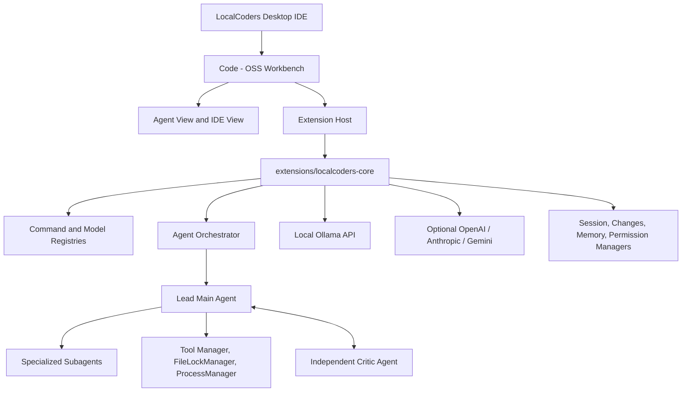

# LocalCoders

**Open-Source, Local-First Multi-Agent AI Coding IDE Built on Code - OSS**

LocalCoders is a standalone desktop AI coding IDE built on Microsoft's open-source Code - OSS foundation with a native Agent View workspace, multi-agent execution and code-review orchestration, local Ollama inference, and optional cloud provider routing.

---

## Core Capabilities

- **Dual Workbench Modes (Agent View and IDE View)**: Switch directly from the titlebar between a distraction-free Agent workspace and the full Code - OSS desktop workbench (Monaco editor tabs, Explorer, Git source control, integrated terminal, debugging, and Open VSX extensions).
- **Live Hardware Telemetry Bar**: Displays live local runtime readiness (`LOCAL Ollama Ready`), CPU model/cores/load, system RAM usage, and GPU VRAM, utilization, and temperature. Automatically unloads running Ollama models to free VRAM when the IDE closes.
- **Iterative Multi-Agent Orchestration**:
  - **Main Agent**: Analyzes tasks, formulates implementation plans, writes/edits files, runs tests, and coordinates subagents.
  - **Specialized Subagents**: Configurable roles including Frontend Developer, Backend Developer, Software Architect, Database Engineer, Debugging Specialist, Test Engineer, Security Auditor, Performance Engineer, Refactoring Specialist, and Documentation Writer.
  - **Critic Agent Loop (`Code -> Critic Review -> Feedback -> Fix -> Re-review`)**: Audits Git diffs, non-Git workspace changes, current source files on disk, and verification command outputs. Feeds blocker or `changes_requested` findings back to the Main Agent across bounded cycles (`maxCriticCycles`) until approved or converged cleanly.
- **34-Command Slash Command System**: Centralized registry (`docs/SLASH_COMMANDS.md`) with keyboard-navigable autocomplete in the composer (`/bypass`, `/normal`, `/auto-approve`, `/permissions`, `/agent`, `/plan`, `/ask`, `/review`, `/model`, `/models`, `/model-info`, `/reasoning`, `/new`, `/clear`, `/sessions`, `/rename`, `/delete-session`, `/export`, `/compact`, `/undo`, `/redo`, `/terminal`, `/git`, `/files`, `/search`, `/diagnostics`, `/run`, `/test`, `/agents`, `/agent-create`, `/agent-status`, `/agent-stop`, `/mcp`, `/help`).
- **Central Model and Provider Registry**: Auto-discovers installed Ollama models, exposes curated hardware-aware model recommendations, manages context window and reasoning-effort parameters, and supports OpenAI, Anthropic, and Google Gemini providers alongside local Ollama serialization.
- **Git and Non-Git Workspace Change Tracking**: Computes unified diffs, line additions/removals, per-file or batch Accept/Reject actions, and safe undo/redo snapshots across both Git repositories and plain local folders.
- **Terminal, Virtual Environments, and Interactive Stdin Control**: Defaults POSIX shell execution to `/bin/bash`, injects workspace `.venv`/`venv` and `node_modules/.bin` into `PATH`, handles interactive prompts cleanly via `run_command(..., stdin)` with fast EOF prompt detection, and provides managed background/interactive processes (`start_process`, `write_stdin`, `read_output`, `terminate_process`).
- **Permission Policies and Hard Security Boundaries**: Supports `Ask Before Actions`, `Smart Approval`, and `Bypass Permissions` while always enforcing workspace path containment, secret redaction, OS file permissions, and explicit confirmation gates for destructive operations.
- **Minimalist Sessions Sidebar and Markdown Rendering**: Manage sessions sorted by Recent, alphabetical order, or grouped by folder with inline rename/delete, rendered headings, lists, links, inline code, and syntax-fenced code blocks.

---

## System Architecture



---

## Prerequisites

- Linux desktop environment (X11 or Wayland)
- Node.js 20 or later and npm
- Git
- Ollama running locally at `http://127.0.0.1:11434` (with at least one local model installed, such as `qwen3.8:27b` or `qwen2.5-coder:7b`)

---

## Development Setup and Testing

### 1. Install Dependencies and Compile Extension

```bash
git clone https://github.com/luongjuan123/LocalCoders.git
cd LocalCoders

npm install
npm --prefix extensions/localcoders-core install
npm --prefix extensions/localcoders-core run compile
```

### 2. Run Automated Test Suite

```bash
npm test
```

The test suite runs `84` automated tests across `13` suites covering tool execution, interactive stdin and virtual environments, Git and non-Git change tracking, multi-round Critic cycles, slash commands, model routing, Ollama integration, session management, file locks, and Agent View / Chat View UI behavior.

### 3. Reconstruct Full Code - OSS Desktop Workbench

The `vscode-src/` runtime build directory is excluded from version control due to upstream Code - OSS history and native dependency size. Custom workbench, branding, and titlebar changes are preserved in `patches/vscode-workbench.patch`:

```bash
# Clone upstream Code - OSS into vscode-src (if setting up from scratch)
git clone --depth 1 https://github.com/microsoft/vscode.git vscode-src
git -C vscode-src apply ../patches/vscode-workbench.patch

# Link or sync extension source into Code - OSS built-in extensions
rsync -a --delete extensions/localcoders-core/src/ vscode-src/extensions/localcoders/src/
npm --prefix vscode-src/extensions/localcoders install
npm --prefix vscode-src/extensions/localcoders run compile
```

### 4. Launch Desktop Application

```bash
# Open current workspace
./bin/localcoders .

# Or open any target project folder
./bin/localcoders /path/to/project
```

---

## Project Structure

```text
LocalCoders/
├── bin/
│   └── localcoders                     Desktop application launcher script
├── branding/
│   ├── localcoders-logo.svg            Vector logo asset
│   ├── localcoders-icon.png            Application icon asset
│   └── product.json                    Code - OSS product configuration
├── docs/
│   ├── ARCHITECTURE.md                 Multi-agent workbench specification
│   └── SLASH_COMMANDS.md               Complete slash command reference
├── electron/                           Electron shell entry and IPC services
├── extensions/localcoders-core/        Built-in AI IDE extension source
│   └── src/
│       ├── agents/                     MainAgent, Subagent, CriticAgent, Orchestrator, Queue, Locks
│       ├── commands/                   Central slash command registry, parser, built-ins, history
│       ├── context/                    ChangesManager, CodebaseIndexer, MemoryManager
│       ├── mcp/                        MCP server host integration
│       ├── models/                     Multi-provider ModelProviderRegistry & LLMRouter
│       ├── ollama/                     Ollama client, model catalogue, hardware telemetry
│       ├── security/                   PermissionManager and security boundary enforcement
│       ├── sessions/                   SessionManager persistence
│       ├── tools/                      Filesystem, Git, Terminal, Process, Search, Browser, DB tools
│       └── views/                      AgentWorkspaceEditorPanel, ChatView, Activity & Markdown UI
├── patches/
│   └── vscode-workbench.patch          Code - OSS workbench, titlebar, and branding patches
├── src/                                React desktop shell components
├── test/                               Automated Node test suite (84 tests across 13 suites)
└── package.json
```

---

## License

MIT License
